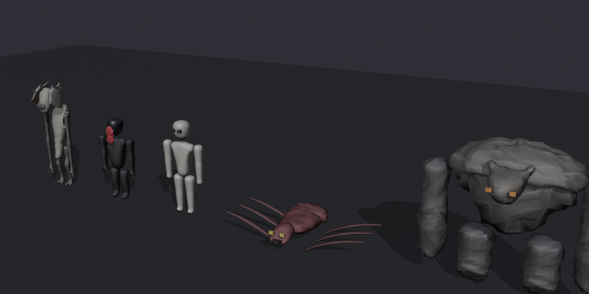

# Modelos de las criaturas



Modelados en Blender 4.5 LTS con `assets/blender/build_creatures.py`. Cada
archivo tiene una pieza por nombre (`Torso`, `Head`, `Arm`, `Leg`...). Cada pieza
ocupa exactamente la caja de la Part que reemplaza en
`src/server/Monsters/MonsterFactory.lua`. Así las uniones, la animación y la IA
siguen iguales.

| Archivo | Piezas | Triángulos |
|---|---|---|
| `fbx/ElOyente.fbx` | Torso, Head, Mouth, Ear, Arm, Leg | 11.904 |
| `fbx/ElImitador.fbx` | Torso, Head, Jaw, Arm, Leg | 8.168 |
| `fbx/ElQuieto.fbx` | Torso, Head, Arm, Leg | 3.360 |
| `fbx/ElTrepador.fbx` | Body, Head, Leg | 4.640 |
| `fbx/ElColoso.fbx` | Torso, Plate, Head, Arm, Leg | 4.984 |

Los ojos siguen siendo Parts de neón. El color y el material (Slate, Fabric,
CorrodedMetal...) los pone el juego. Si una malla trae textura propia, el juego la
respeta.

## Importarlos en Studio (una sola vez)

Roblox sólo usa mallas subidas a tu cuenta, así que este paso no se puede hacer
desde el código.

1. En `ServerStorage` creá una carpeta llamada `NocturnaModels`. Si usás
   `rojo serve` o un build de Rojo, ya está creada.
2. **Home → Import 3D** y elegí `fbx/ElOyente.fbx`. En la ventana del importador
   dejá *Merge Meshes* desactivado y apretá **Import**.
3. Movés el modelo importado a `ServerStorage/NocturnaModels` y le dejás el
   nombre `ElOyente`.
4. Repetís con las otras cuatro.
5. Para que Rojo lo incluya en los próximos builds: clic derecho sobre cada modelo
   → **Save to File** → guardalo como `assets/models/rbxm/ElOyente.rbxm`, y así con
   las otras cuatro. Después hacés el commit.

El juego busca cada pieza por nombre dentro de `NocturnaModels/<Criatura>`. Si
falta una, usa la Part simple de siempre. El Quieto y los maniquíes del capítulo
5 comparten las mismas mallas.

**Si una criatura aparece mirando hacia atrás**, poné el atributo booleano
`TurnAround = true` en la carpeta `NocturnaModels`. El juego gira todas las
mallas media vuelta. Las piezas se exportan con el frente hacia -Y de Blender,
la convención habitual para Roblox, pero el resultado del importador
todavía no se comprobó en Studio.

## Regenerar o modificar

```bash
blender --background --factory-startup --python assets/blender/build_creatures.py -- assets/models
```

Rehace los FBX, los renders de `previews/` y `NOCTURNA_Creatures.blend`. Para
cambiar una forma, editá su función en el script (por ejemplo `coloso_arm`).
Para cambiar tamaños o posiciones, cambiá `CREATURES` en el script y
`MonsterFactory` a la vez: tienen que coincidir.

Los FBX nuevos hay que volver a importarlos en Studio.
