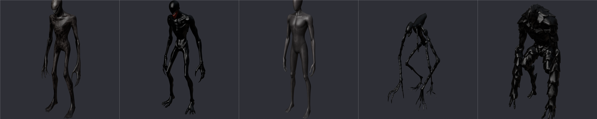

# Criaturas realistas generadas con IA



Las cinco criaturas (`<Criatura>.glb` en esta carpeta) se generaron en
[Meshy](https://www.meshy.ai) con **Image to 3D**, a partir de las láminas de
concepto de `concept/`. Se usó el modelo **Meshy 6 Lite** (el único que el plan
gratis deja descargar) con textura PBR. Licencia: **CC BY 4.0**, con uso
comercial permitido dando crédito a Meshy.

`assets/blender/prepare_ai_models.py` las deja listas para Roblox. Las vistas
previas están en `../previews/<Criatura>_AI.png` y, con un color por pieza, en
`../previews/<Criatura>_AI_pieces.png`.

## Qué hace la preparación

```bash
blender --background --factory-startup --python assets/blender/prepare_ai_models.py -- assets/models
```

1. Reduce cada malla a 18.000 triángulos y las texturas a 1024 px, los límites
   de Roblox.
2. La escala a una altura fija (`FIT`), centrada y con los pies en el piso. Las
   puertas miden 9 studs y el techo 13.
3. La corta en las piezas que anima el juego (torso, cabeza, brazos, piernas...)
   según `AI_BOXES`. Esas cajas se midieron sobre la silueta de cada modelo para
   que los cortes caigan en el hombro, la cadera y el cuello.
4. Escribe `../fbx/<Criatura>_AI.fbx` con las texturas adentro, los mapas sueltos
   en `../ai_textures/<Criatura>/` y, en `src/server/Monsters/CreatureMeshes.lua`,
   dónde va cada pieza (`Offset`, `Box`) y su tamaño real (`Size`, `Shift`).

En el juego, los brazos y las piernas giran desde el hombro y la cadera.

| Criatura | Altura | Triángulos (original → final) |
|---|---|---|
| El Oyente | 8,4 | 48.518 → 17.459 |
| El Imitador | 7,2 | 76.780 → 17.459 |
| El Quieto | 7,2 | 37.822 → 17.459 |
| El Trepador | 7,0 | 102.296 → 17.459 |
| El Coloso | 9,0 | 195.538 → 17.460 |

## Importar en Studio (una sola vez)

**Ya están importadas.** Las cinco se subieron a Roblox desde Studio y quedaron
en `../rbxm/<Criatura>.rbxmx`, con sus mallas y su SurfaceAppearance. Rojo las
pone en `ServerStorage/NocturnaModels` en cada build. Los pasos de abajo sólo
hacen falta si rehacés una criatura.

1. En `ServerStorage` creá la carpeta `NocturnaModels`. Si usás Rojo, ya está.
2. **Home → Import 3D** y elegí `assets/models/fbx/ElOyente_AI.fbx`. Dejá
   *Merge Meshes* desactivado.
3. Mové el modelo importado a `ServerStorage/NocturnaModels` y llamalo `ElOyente`.
4. Repetí con las otras cuatro (`ElImitador_AI.fbx`, `ElQuieto_AI.fbx`,
   `ElTrepador_AI.fbx`, `ElColoso_AI.fbx`).
5. Para que Rojo los incluya: clic derecho → **Save to File** →
   `assets/models/rbxm/<Criatura>.rbxmx` (reemplazá el anterior).

El juego reconoce las piezas (`Torso1`, `Arm1`, `Arm2`...) y las ubica con las
medidas de `CreatureMeshes.lua`. Los maniquíes del capítulo 5 usan las mismas
mallas que El Quieto.

**Si el importador no aplica las texturas**, agregá una **SurfaceAppearance**
dentro de `NocturnaModels/<Criatura>` con los mapas de
`assets/models/ai_textures/<Criatura>/`:

| Propiedad | Archivo |
|---|---|
| ColorMap | `<Criatura>_Color.png` |
| NormalMap | `<Criatura>_Normal.png` |
| RoughnessMap | `<Criatura>_Roughness.png` |
| MetalnessMap | `<Criatura>_Metalness.png` |

El juego la copia a todas las piezas de esa criatura.

**Si una criatura aparece mirando hacia atrás**, poné `TurnAround = true` en la
carpeta `NocturnaModels`.

## Piezas opcionales para la animación

Las criaturas se animan por código (no hay animaciones subidas). Con los cortes
actuales cada extremidad es una sola pieza rígida y la boca de El Imitador es un
parche cortado de la cabeza (`Jaw1`), que apenas se entreabre. Si alguna vez se
agregan estas mallas en `NocturnaModels/<Criatura>`, el juego las usa solo:

| Malla | Qué hace |
|---|---|
| `ElImitador/Jaw` | Mandíbula propia: gira desde arriba y atrás y se abre del todo al gritar y atacar (reemplaza a `Jaw1`). |
| `ElImitador/Tongue` | Lengua: queda dentro de la boca y sale cuando la boca está bien abierta. |
| `<Criatura>/<Pieza><n>Lower` (por ejemplo `ElTrepador/Leg1Lower`) | Parte baja de una pierna o brazo: se cuelga del extremo de la pieza de arriba y se dobla en la rodilla o el codo (dos huesos). Para eso la pieza de arriba tiene que cortarse sólo hasta la rodilla. |

## Rehacer una criatura

Generala de nuevo en Meshy desde `concept/para_meshy/<Criatura>.png` (Image to
3D, Meshy 6 Lite, con textura), descargala en GLB como `<Criatura>.glb` en esta
carpeta y volvé a correr la preparación. Si el modelo nuevo tiene otras
proporciones, conviene ajustar sus cajas en `AI_BOXES` y revisar
`<Criatura>_AI_pieces.png`.

## Crédito obligatorio

Con el plan gratis de Meshy hay que dar crédito, por ejemplo en la descripción
de la experiencia: *"Modelos de criaturas creados con Meshy (CC BY 4.0)"*.
