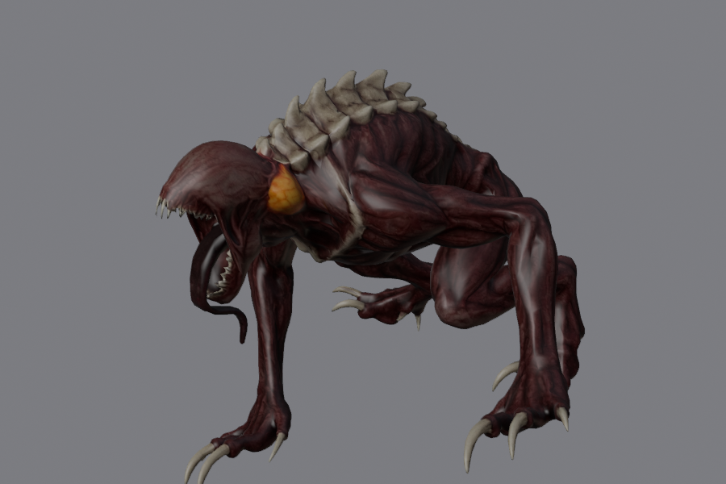

# El Organismo en Roblox

## Versión actual: modelo de Meshy con esqueleto

El monstruo de la persecución final es `assets/models/ai/ElOrganismo.glb`, generado
en [Meshy](https://www.meshy.ai) con **Image to 3D** (modelo Meshy 6 Lite, textura
PBR, licencia CC BY 4.0) a partir de un concepto propio: un cuadrúpedo agazapado,
con cresta de hueso, garras largas, lengua y un saco brillante en la nuca.

`assets/blender/rig_organismo.py` suelda las costuras, lo reduce a 17.730
triángulos, le arma un esqueleto de 20 huesos (`meshy/bones.json`), pesa la piel y
exporta `meshy/ElOrganismoRig.fbx` y las texturas a 1024 px.

| Qué | Id de Roblox |
|---|---|
| Modelo con esqueleto (`ElOrganismoRig.fbx`) | 128771559250205 |
| Color / Normal / Roughness | 135094894866550 / 110057460127565 / 127859122747577 |

`tools/studio/install_organismo_rig.luau` lo deja en
`ReplicatedStorage.NocturnaAssets.OrganismoRig` (una MeshPart con sus huesos y una
SurfaceAppearance). Si está, `ChaseCreature.lua` usa esa versión y la anima girando
los huesos (galope, rugido, embestida y la escena de tragar).

Dos cosas que costó descubrir:

- El importador deja la malla 100 veces más grande. Para achicarla hay que cambiar
  `Size` **y** multiplicar la posición de cada hueso; cambiar sólo `Size` (o usar
  `Model:ScaleTo`) deja los huesos en su lugar y la piel se estira cientos de studs.
- En la barra de comandos de Studio, `require` devuelve la versión del módulo que
  cargó primero aunque cambie su `Source`. Para probar código nuevo:
  `require(modulo:Clone())`.

## Versión anterior: piezas modeladas en Blender

Si `OrganismoRig` no está, `ChaseCreature.lua` arma la criatura con las piezas de
`ReplicatedStorage.NocturnaAssets.Organismo` (grupo `Organismo` de
`assets/models/props/NocturnaProps.fbx`, modelo 73180203680518) o, si tampoco están,
con formas simples. Texturas de esas piezas:

| Qué | Id de Roblox |
|---|---|
| OrganismoFlesh Color / Normal / Roughness | 120753309483474 / 82475769405359 / 110891094884569 |
| OrganismoPlate Color / Normal / Roughness | 124341745303686 / 85701142822629 / 110840020343864 |
