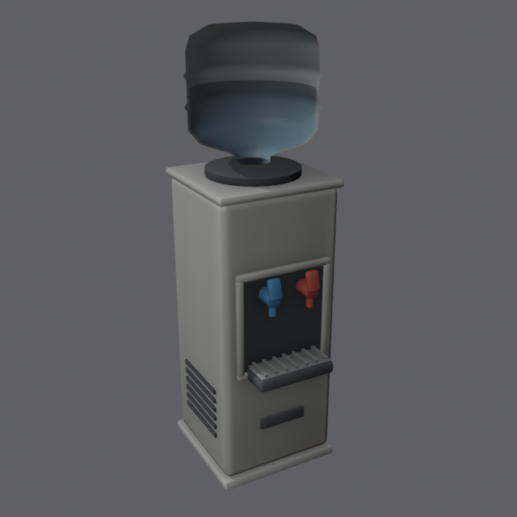

# Utilería con mallas (Meshy, Tripo, Blender…)

## Juego modelado en Blender (`NocturnaProps.fbx`)

`assets/blender/build_props.py` modela 19 objetos con geometría propia (biseles,
piezas torneadas, caños barridos por curvas, telas con arrugas, carne deformada con
ruido). Cada objeto sale partido por material: una MeshPart por grupo
(`<Objeto>__<Grupo>`), así el dispenser son 7 piezas y no 40.

| Objeto | Grupos | Triángulos |
| --- | --- | --- |
| `WaterCooler` | cuerpo, hueco oscuro, rejilla y serpentina, canilla roja y azul, bidón con estrías, agua | 3.676 |
| `HospitalBed` | caños, ruedas, cabecera y pie, colchón con almohada, sábana que cae, suero | 7.764 |
| `Desk` | madera, metal, monitor de tubo, pantalla, papeles, silla de oficina | 5.210 |
| `FilingCabinet` | cuerpo con un cajón abierto, tiradores, carpetas | 1.056 |
| `Bookcase` | madera, libros en tres tonos | 9.840 |
| `Sofa` | tapizado, almohadones, patas | 5.496 |
| `Wheelchair` | bastidor con rayos, cubiertas, asiento | 5.840 |
| `TrashBin` | tacho con pedal, bolsa, papeles | 2.148 |
| `Extinguisher` | cuerpo, válvula y soporte, manguera, etiquetas, cartel | 1.776 |
| `Plant` | maceta, tierra, ramas secas, hojas | 7.296 |
| `LabTable` | mueble, mesada, pileta y microscopio, vidrio, reactivos, líquidos | 4.780 |
| `SpecimenTank`, `_2`, `_3` | estructura, vidrio, líquido (con luz y burbujas), espécimen, luces | 9.100 – 12.296 |
| `GrowthMass`, `_2` | carne, venas, bolsas | 5.778 – 6.098 |
| `WallGrowth`, `_2` | piel sobre la pared, venas, bolsas | 12.400 – 12.522 |
| `OperatingTable` | acero, colchonetas, correas, paño, lámpara, focos, instrumental, sangre | 9.552 |

Las variantes `<Nombre>_2`, `_3` se reparten solas (`PropKit.Template`): dos
cápsulas seguidas nunca son iguales (feto en líquido verde, masa de tentáculos en un
tanque medio vacío ámbar, cerebro con médula en líquido rojo).

`props.json` dice el material de Roblox, color, transparencia y colisión de cada
grupo. Los de carne llevan la textura `OrganismoFlesh` (SurfaceAppearance); el resto
toma solo las texturas PBR del capítulo (MaterialVariant por material). El líquido de
las cápsulas lleva luz y burbujas.

Regenerar: `blender -b --factory-startup -P assets/blender/build_props.py -- --out C:/tmp/ntp`
(deja el FBX, `props.json`, `triangles.json` y las vistas previas).

Instalar en el lugar: subir `NocturnaProps.fbx` como modelo y correr
`tools/studio/install_props.luau` en la barra de comandos con el id del modelo.

## Cómo reemplazar un objeto a mano

Todo el mundo de NOCTURNA se arma con piezas procedurales. Cualquier objeto de la
lista de abajo se puede reemplazar por una malla **sin tocar código**:

1. Importá el modelo en Studio (Importador 3D) y dejalo como un `Model` (con una o
   varias `MeshPart`) o como una sola `MeshPart`.
2. Ponele exactamente el nombre de la tabla (por ejemplo `Fuse`).
3. Guardalo en `ServerStorage/NocturnaProps/<Nombre>`.

`PropKit.Visual` (en `src/server/World/PropKit.lua`) busca ese nombre cada vez que
construye el objeto. Si lo encuentra, clona la malla, la escala **sin deformarla**
para que entre en la caja indicada, la apoya en el piso de la caja y la ancla. Si no
lo encuentra, usa la versión procedural de siempre.

Reglas para que quede bien:

- **Orientación:** el frente del objeto mira hacia **-Z** (en Studio, la cara
  *Front*). Para muebles, el respaldo va hacia **+Z** (contra la pared).
- **Escala:** no importa el tamaño original; se ajusta a la caja manteniendo las
  proporciones. Conviene que la malla tenga proporciones parecidas a la caja.
- **Piezas funcionales:** los prompts, indicadores, ranuras de fusibles, puertas de
  escondite y luces siguen siendo procedurales y se agregan aparte, así que la malla
  sólo tiene que ser lo que se ve.
- **Escondites:** la cámara queda adentro, detrás de la puerta (ver la columna
  "notas"). La malla tiene que dejar rendijas reales a esa altura o el jugador no va
  a ver nada.
- **Rendimiento:** cada `MeshPart` cuenta para el tope de ~2400 piezas por capítulo
  (pensado para celulares). Mejor pocas piezas con buena textura que muchas chicas.
- Usá texturas PBR (`SurfaceAppearance`) de colores apagados: la iluminación es
  `Future`, así que el metal, el vidrio y la madera se notan de verdad.

Medidas en studs: ancho (X) × alto (Y) × profundidad (Z).

## Objetos que se juntan

| Nombre | Caja (X × Y × Z) | Notas |
| --- | --- | --- |
| `Fuse` | 1.8 × 0.6 × 0.6 | Fusible de cartucho de vidrio, acostado. |
| `Battery` | 0.7 × 1.4 × 0.7 | Pila grande, parada. |
| `Medkit` | 1.8 × 1 × 1.2 | Valija de primeros auxilios. |
| `Key` | 1.4 × 0.2 × 0.6 | Llave vieja, acostada. |
| `Keycard` | 1 × 0.15 × 0.7 | Tarjeta de acceso, acostada. |
| `Radio` | 1.6 × 2 × 0.7 | Radio portátil con antena. |
| `Sample` | 1.2 × 1.3 × 0.6 | Frasco con muestra en gradilla. |
| `MemoryShard` | 1 × 0.1 × 0.8 | Pedazo de foto. |
| `PickupStand` | 1.8 × 1.6 × 1.6 | Caja donde apoyan los objetos (el objeto queda a 1.56 de alto). |

## Escondites

| Nombre | Caja (X × Y × Z) | Notas |
| --- | --- | --- |
| `Locker` | 3.4 × 7.6 × 2.8 | Casillero. Cámara a 5.45 de alto, puerta en Z = -1.4. Persianas entre 4.55 y 6.35. |
| `Wardrobe` | 4.6 × 7.8 × 2.6 | Ropero / armario de dos puertas. Cámara a 5.4, persianas entre 4.3 y 6.5. |
| `HideDesk` | 6 × 3 × 3.2 | Escritorio: el jugador se mete en el hueco de las rodillas (X ≈ 0.8). Cámara a 1.45. |
| `HideBed` | 7.4 × 3.2 × 3.8 | Cama: el jugador va abajo. Cámara a 0.8; el bastidor empieza a 1.3. |
| `VentDuct` | 4.2 × 12.9 × 3.4 | Tronco de ventilación del piso al techo; rejilla de acceso entre 0.3 y 3.15. Cámara a 1.75. |

## Máquinas

| Nombre | Caja (X × Y × Z) | Notas |
| --- | --- | --- |
| `Generator` | 6.4 × 6.2 × 4.4 | Grupo electrógeno. El tablero de fusibles va aparte. |
| `FusePanel` | 3 × 3.2 × 0.8 | Caja del tablero (las ranuras y fusibles se agregan solas). |
| `Terminal` | 5 × 5.4 × 2.8 | Consola con monitor (la pantalla se agrega sola). |
| `Valve` | 3.4 × 13 × 3 | Cañería con válvula (el volante se agrega solo). |
| `Core` | 7 × 11 × 7 | Contención del Núcleo (la columna de energía se agrega sola). |
| `ExitDoor` | 9 × 10 × 2.4 | Salida blindada / ascensor (balizas y botonera se agregan solas). |
| `DocumentTable` | 3 × 2.6 × 2 | Mesita donde aparecen los documentos. |

## Muebles de las salas

| Nombre | Caja (X × Y × Z) | Notas |
| --- | --- | --- |
| `Desk` | 5.6 × 4.4 × 4.6 | Escritorio con silla adelante. |
| `FilingCabinet` | 2 × 4.6 × 2.2 | Archivero metálico. |
| `Shelf` | 6 × 7.2 × 2 | Estantería con cajas. |
| `Bookcase` | 6 × 8 × 1.8 | Biblioteca / biblioratos. |
| `LabTable` | 7 × 4.4 × 3 | Mesada de laboratorio con repisa. |
| `HospitalBed` | 3.6 × 6.2 × 7.4 | Cama de hospital, cabecera contra la pared. |
| `Wheelchair` | 2.4 × 3.4 × 3 | Silla de ruedas. |
| `Workbench` | 7 × 6.5 × 2.6 | Banco de trabajo con tablero de herramientas. |
| `CrateStack` | 6 × 5.5 × 4 | Cajones sobre un pallet. |
| `BarrelGroup` | 5.5 × 4.2 × 3 | Tambores. |
| `ElectricalPanel` | 3 × 4.6 × 1.2 | Tablero eléctrico de pared con caños. |
| `ServerRack` | 3.2 × 7.4 × 2.4 | Rack de servidores. |
| `Sofa` | 7 × 3.2 × 3 | Sillón. |
| `KitchenCounter` | 8 × 7.4 × 2.4 | Mesada de cocina con alacenas. |
| `ChildBed` | 3.4 × 3 × 6.4 | Cama de chico con peluche. |
| `Dresser` | 4.4 × 6 × 2 | Cómoda con espejo. |
| `TVStand` | 4 × 4.4 × 2 | Mueble con televisor viejo. |
| `SpecimenTank` | 3.4 × 8.4 × 3.4 | Tanque de especímenes. |
| `OperatingTable` | 3 × 10 × 6.6 | Camilla de operaciones con lámpara. |
| `GrowthMass` | 5 × 6 × 4 | Masa orgánica con venas. |
| `Boiler` | 4.4 × 8.6 × 4 | Caldera. |
| `WaterCooler` | 1.4 × 4.4 × 1.4 | Dispenser de agua. |
| `Plant` | 1.6 × 4.2 × 1.6 | Planta seca en maceta. |
| `Extinguisher` | 1 × 2.6 × 0.8 | Matafuego con cartel. |
| `TrashBin` | 1.4 × 1.8 × 1.4 | Tacho de basura. |

## Utilería de rincón

| Nombre | Caja (X × Y × Z) | Notas |
| --- | --- | --- |
| `Crate` | 4 × 5 × 4 | Cajones apilados. |
| `Barrel` | 3 × 4.5 × 3 | Tambor oxidado. |
| `CornerPipe` | 2 × 13 × 2 | Cañería vertical del piso al techo. |
| `Cable` | 3 × 4 × 3 | Carretel de cable. |

En los rincones también se usan `Desk`, `Plant`, `GrowthMass` y `SpecimenTank` de
la tabla de muebles. Los rincones con varios muebles juntos (archiveros dobles, mesa
con silla) se arman siempre con piezas procedurales.
