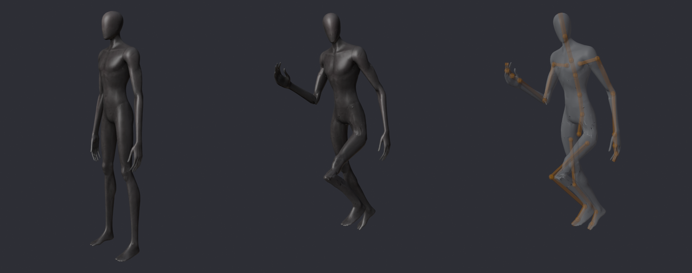

# Criaturas con esqueleto (malla con piel)

Las criaturas cortadas en piezas rígidas (`../fbx/<Criatura>_AI.fbx`) no pueden
doblar rodillas ni codos: cada brazo y cada pierna es una sola pieza. Acá está la
misma malla realista **entera, con piel y huesos**, para que el juego doble las
articulaciones de verdad.

| Archivo | Qué es |
|---|---|
| `<Criatura>.fbx` | Malla con piel + esqueleto en pose de descanso, color y normal adentro (1024 px). Para importar en Studio. |
| `<Criatura>.json` | Huesos: nombre, padre, cabeza, cola y largo (studs, relativos a la raíz, frente -Z). |
| `../previews/<Criatura>_rig.png` | Descanso, pose doblada (rodilla y codo) y los huesos a través de la piel. |
| `src/server/Monsters/CreatureRigs.lua` | Medidas que usa el juego (alto, cadera, distancia cadera-cabeza, huesos). |



## Cómo se arma

```bash
blender --background --factory-startup --python assets/blender/rig_creatures.py -- assets/models [Criatura ...]
```

`assets/blender/rig_creatures.py`, por cada `../ai/<Criatura>.glb`:

1. Une la malla, la reduce a 18.000 triángulos y la lleva al juego con la misma
   escala, frente y altura de pies que `prepare_ai_models.py` (las alturas de
   `MonsterConfig` siguen valiendo). Suelda los vértices que el glTF parte en las
   costuras de UV (si no, la piel se abre al doblar).
2. Marca la región de cada vértice (torso, cabeza, brazo, pierna...) con las cajas
   de `AI_BOXES`; entre extremidades corrige recorriendo la superficie (la mano
   que cuelga junto a la rodilla es del brazo, no de la pierna).
3. Mide la anatomía de cada región sobre la malla: cortes horizontales dan la
   cadera, la rodilla (donde la pata se dobla o la mitad), el tobillo (lo más
   angosto abajo), la punta del pie, el hombro, el codo, la muñeca y los dedos;
   el torso da la columna y la cabeza el cuello. Imprime todo (`[NOCTURNA rig]`).
4. Arma el esqueleto, lo pesa con **pesos automáticos** de Blender y limpia: cada
   vértice sólo depende de huesos de su región o vecinos; donde el cálculo
   automático no da nada usa el hueso más cercano; suaviza las uniones y deja
   **4 huesos por vértice como máximo** (límite de Roblox). En El Coloso el
   brazo que cuelga viene fundido al muslo: esas caras (85) se separan para que
   al levantar el brazo no se estire una "tela".
5. Exporta el FBX (Y arriba, escala 1, sin huesos hoja, texturas adentro), el
   JSON, la vista previa y `CreatureRigs.lua`.

### Huesos

Todos tienen `Root` (en la raíz de la criatura, sin vértices), `Hips`, `Spine1`,
`Spine2`, `Chest`, `Neck`, `Head`, y de cada lado (`Left`/`Right`):
`Clavicle`, `UpperArm`, `Forearm`, `Hand`, `Fingers1`, `Fingers2`, `Thigh`,
`Shin`, `Foot`, `Toe`. Además:

| Criatura | Extra |
|---|---|
| El Imitador | `Jaw` (mandíbula: la boca roja se abre de verdad) |
| El Trepador | `Spine3` y `Abdomen` (cuerpo segmentado); los brazos son sus patas delanteras largas (cinco segmentos con garras) |
| El Coloso | `PlateLeft`, `PlateRight`, `PlateBack` (placas del caparazón sueltas que rebotan con las pisadas) |

| Criatura | Huesos | Triángulos | Alto (studs) |
|---|---|---|---|
| El Oyente | 27 | 17.459 | 8,4 |
| El Imitador | 28 | 17.459 | 7,2 |
| El Quieto | 27 | 17.459 | 7,2 |
| El Trepador | 29 | 17.459 | 7,0 |
| El Coloso | 30 | 17.375 | 9,0 |

## Importar en Studio (una vez por criatura)

1. **Home → Import 3D** y elegí `assets/models/rigged/ElOyente.fbx`.
2. En la ventana del importador:
   - *File General*: **Scale Unit = Stud** (o la que deje el modelo de unos
     8,4 studs de alto; el juego corrige la escala igual si quedó en otra
     unidad, ver abajo). *World Up* Y. *Merge Meshes* desactivado.
   - *Rig General*: **Rig Type = Custom** (no R15) y **Keep Zero Influence
     Bones** activado (el hueso `Root` no pesa vértices; si se pierde igual
     funciona, pero es mejor tenerlo).
   - Que no avise de huesos faltantes ni de más de 4 influencias.
3. Insertá el modelo, renombralo **`ElOyenteRig`** y movelo a
   **`ServerStorage.NocturnaModels`** (al lado de la carpeta `ElOyente` con las
   piezas, que queda de respaldo). Adentro tiene que haber una MeshPart con los
   huesos (`Bone`) colgando de ella o de una parte raíz. Si el importador agregó
   un `Humanoid` o un `AnimationController`, no molesta (el juego los quita).
4. Texturas: el FBX trae color y normal. Para que tenga también rugosidad y
   metal (como las piezas), borrá la `SurfaceAppearance` que haya creado el
   importador: el juego le copia la de `NocturnaModels/ElOyente` (mismas UV,
   los cuatro mapas). Si querés ponerla a mano, usá los mapas de
   `assets/models/ai_textures/ElOyente/`.
5. Para que Rojo lo incluya: clic derecho → **Save to File** →
   `assets/models/rbxm/ElOyenteRig.rbxmx`.
6. Repetí con `ElImitador`, `ElQuieto`, `ElTrepador` y `ElColoso`
   (`<Criatura>Rig`).

### Probar

- **Play**: no debería aparecer en Output `[NOCTURNA] <Criatura>Rig no sirve`
  (faltan huesos o la MeshPart) ni `No se pudo escalar`. Con ese aviso la
  criatura se arma con piezas como antes.
- La criatura queda con los pies en el piso y del mismo alto que antes. El juego
  la ubica por sus huesos: el hueso `Root` (o `Hips`) sobre la raíz y el costado
  de cadera a cadera, así que no importa dónde ni girada como la deje el
  importador. Si igual apareciera mirando hacia atrás, poné el atributo
  `RigTurnAround = true` en `NocturnaModels`.
- Escala: el juego compara la distancia cadera-cabeza con `CreatureRigs.lua` y,
  si difiere más de 3 %, escala el modelo (`Model:ScaleTo`).
- Los maniquíes del capítulo 5 usan `ElQuietoRig` también.

## Cómo se anima

`src/client/Effects/CreatureBones.lua` escribe `Bone.Transform` en cada cuadro,
sólo en el cliente y con el mismo LOD que antes. `MonsterAnimator` sigue
decidiendo la pose (estados, paso medido con la velocidad real, ataque, mirada,
respiración, aturdido, captura...) y la escribe en los huesos:

- **Piernas con IK de dos huesos**: el pie apoyado queda clavado en el piso
  mientras el cuerpo avanza; al despegar hace un arco hasta donde va a pisar; la
  rodilla se dobla sola hacia su lado y la cadera baja lo justo para que las dos
  piernas lleguen. El pie despega con la punta y llega con el talón.
- **Brazos**: péndulo con codo que se dobla con retraso, mano y dedos (garras que
  se cierran al golpear).
- **Columna**: la cadera gira con las piernas y los hombros al revés; la
  inclinación y el balanceo se reparten entre las vértebras; cuello y cabeza
  reparten la mirada.
- **El Trepador**: las cuatro patas pisan con IK y fase propia; el pecho se
  inclina para que las delanteras lleguen; el abdomen se balancea.
- **El Coloso**: pasos pesados (la cadera se hunde con cada pisada), placas
  sueltas que rebotan.
- **Captura**: `CaptureAnimator` usa `CreatureBones.Capture` (mandíbula, cuello,
  brazos que agarran, pies en el piso). Mientras está `AnimOverride`,
  `MonsterAnimator` no toca los huesos. Las piezas invisibles `Head` y `Jaw`
  siguen a sus huesos para la cámara de la captura y los efectos de la boca.

Sin `<Criatura>Rig` en `NocturnaModels` todo funciona como antes (piezas con
Motor6D).
